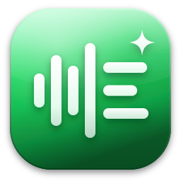
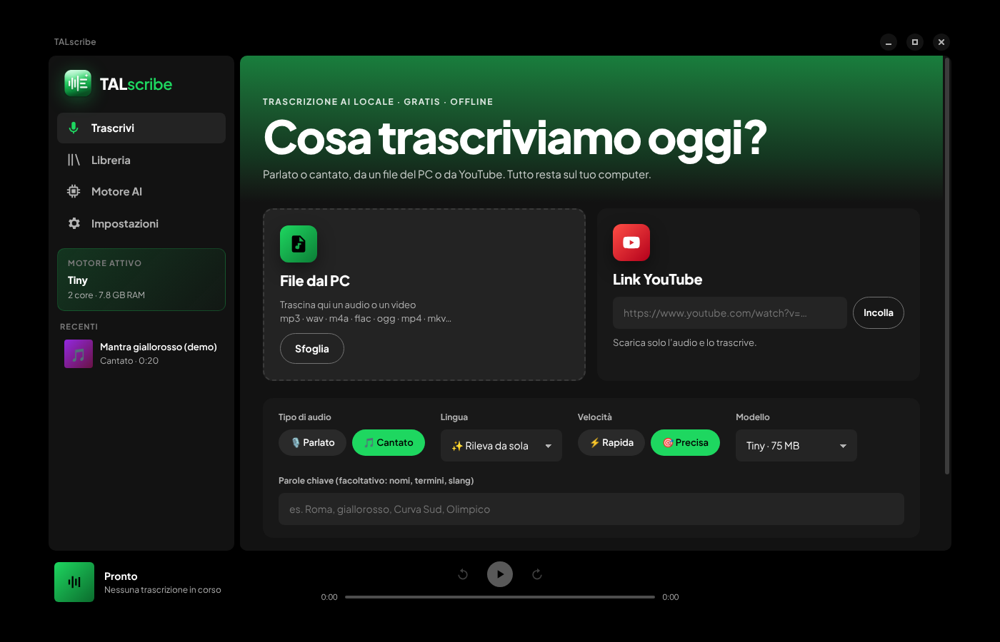
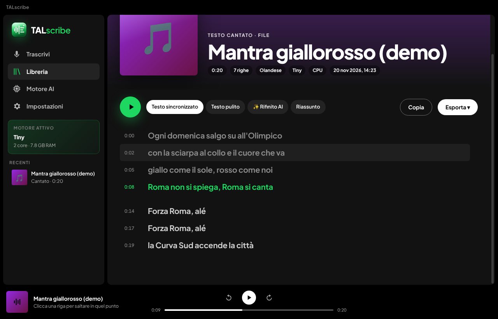
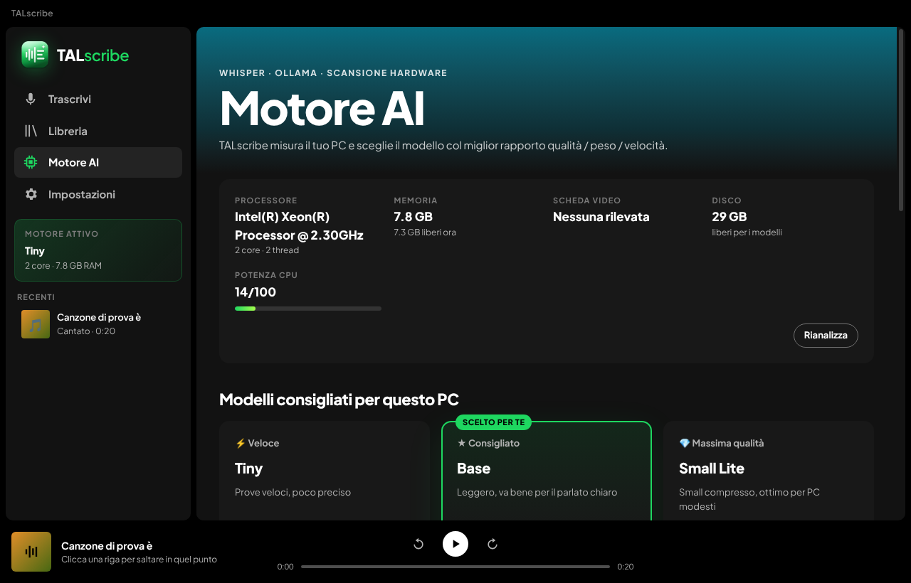

<p align="center">
  
</p>

<h1 align="center">TALscribe</h1>

<p align="center"><b>Trascrizione AI locale di audio parlato e cantato, da file o da YouTube.</b><br>
Gratis, offline, tutto resta sul tuo PC.</p>

<p align="center"></p>

## Download

Scarica `TALscribe-<versione>-win-x64.zip` dalla pagina [Releases](../../releases), estrai **tutta** la cartella e avvia `TALscribe.exe`.
Se Windows mostra "PC protetto da Windows": *Ulteriori informazioni → Esegui comunque* (l'app non è firmata digitalmente).

## Cosa fa

- **Trascrive** file audio e video (mp3, wav, m4a, flac, ogg, mp4, mkv…) o un **link YouTube**, sia **parlato** sia **cantato**
- **Scansione del PC** al primo avvio (CPU, core, RAM, GPU NVIDIA e VRAM, disco, mini benchmark) e proposta di tre modelli: Veloce, Consigliato, Massima qualità
- **Testo sincronizzato** stile karaoke: l'audio scorre, la riga attiva si illumina, un clic su una riga salta in quel punto
- **Esporta** in TXT, TXT con tempi, SRT, VTT e LRC
- **Parole chiave** per aiutare il riconoscimento di nomi propri e slang
- **GPU NVIDIA**: pacchetto CUDA facoltativo scaricabile dall'app; se la GPU dà problemi ripiega da solo sulla CPU
- **Rifinitura con Ollama** (facoltativa): impagina strofe e ritornelli, sistema punteggiatura e paragrafi, fa riassunti
- **Libreria** con ricerca di tutte le trascrizioni

<p align="center">
  
  
</p>

## Come funziona

| Componente | Ruolo |
|---|---|
| [whisper.cpp](https://github.com/ggml-org/whisper.cpp) v1.9.2 | Motore di trascrizione con i modelli Whisper (da Tiny 75 MB a Large v3 2,9 GB, scaricati da Hugging Face al primo uso) |
| [Ollama](https://ollama.com) | Facoltativo: modello linguistico locale (Qwen 2.5) per rifinire il testo. Ollama non trascrive l'audio |
| [yt-dlp](https://github.com/yt-dlp/yt-dlp) + [Deno](https://deno.com) | Download dell'audio da YouTube (aggiornabile dall'app) |
| [FFmpeg](https://ffmpeg.org) | Conversione audio a 16 kHz mono |
| [Electron](https://www.electronjs.org) | Interfaccia desktop |

Dati: `%LOCALAPPDATA%\TALscribe` (modelli e trascrizioni). Registro errori: `%APPDATA%\TALscribe\talscribe-log.txt`.

### Modelli consigliati

| Hardware | Consigliato |
|---|---|
| GPU NVIDIA con 6 GB di VRAM o più | Large v3 Turbo |
| GPU NVIDIA con 4-6 GB | Large v3 Turbo Lite (q5) |
| Solo CPU, 8+ core e 12+ GB di RAM | Large v3 Turbo Lite (q5) |
| Solo CPU, 4+ core e 8+ GB di RAM | Small o Medium Lite |
| PC leggero | Base |

Per i testi cantati conviene il modello più grande che il PC regge.

## Struttura

```
main.js          processo principale Electron (IPC, download, cronologia, export)
preload.js       ponte sicuro verso l'interfaccia
lib/hardware.js  scansione hardware e benchmark
lib/models.js    catalogo modelli Whisper e logica di raccomandazione
lib/transcribe.js pipeline yt-dlp → ffmpeg → whisper-cli
lib/formats.js   pulizia segmenti e formati TXT/SRT/VTT/LRC
lib/ollama.js    rifinitura e riassunto tramite Ollama
ui/              interfaccia (HTML/CSS/JS, palette Spotify, font Plus Jakarta Sans)
assets/          logo (SVG, PNG, ICO)
tools/           script di build
```

## Build dello zip per Windows

La build gira su Linux (o WSL) e produce una cartella portatile con `TALscribe.exe`.

```bash
cd tools
npm install
npm run deps    # scarica Electron, whisper.cpp, FFmpeg, yt-dlp, Deno e runtime VC++ in ../dl
npm run logo    # (facoltativo) rigenera PNG e ICO da assets/logo.svg
npm run build   # crea dist/TALscribe e dist/TALscribe-<versione>-win-x64.zip
```

Requisiti: Node 20+, `zip`, `unzip`, `curl`, `pip`.

## Note

Scarica da YouTube solo contenuti tuoi o che hai il diritto di usare.
Licenze dei componenti inclusi: whisper.cpp (MIT), yt-dlp (Unlicense), Deno (MIT), FFmpeg (GPL), Electron (MIT), Plus Jakarta Sans (OFL).
